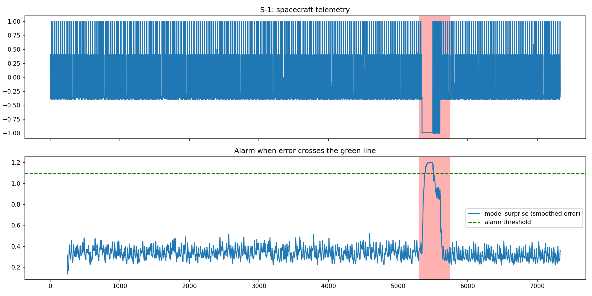

# Spacecraft Anomaly Detection Using LSTM

## Project Overview

This project explores time-series anomaly detection using Long Short-Term Memory (LSTM) neural networks on NASA spacecraft telemetry data.

The goal is to identify unusual spacecraft behavior by predicting telemetry values and detecting unusually large prediction errors.

## Dataset

- **Dataset:** NASA SMAP and MSL Anomaly Detection Dataset
- **Data type:** Spacecraft telemetry time series
- **Evaluation:** Expert-labeled anomaly intervals
- **Experiment scope:** 8 telemetry channels from SMAP

## Technologies Used

- Python
- NumPy
- Pandas
- Matplotlib
- PyTorch
- LSTM Neural Networks
- Scikit-learn concepts

## Methodology

1. Loaded and prepared spacecraft telemetry data.
2. Created sequences using the previous 250 time steps.
3. Trained a two-layer LSTM model to predict the next telemetry value.
4. Calculated prediction errors using absolute differences.
5. Smoothed errors using Exponentially Weighted Moving Average (EWMA).
6. Applied a dynamic threshold to identify potential anomalies.
7. Compared the results with a statistical z-score baseline.

## Model Architecture

- Two LSTM layers
- 80 hidden units
- Dropout: 0.3
- Optimizer: Adam
- Learning rate: 0.001
- Loss function: Mean Squared Error (MSE)

## Results

The experiment was conducted on 8 SMAP telemetry channels containing 11 expert-labeled anomalies.

| Metric | Z-score Baseline | LSTM |
|---|---:|---:|
| Anomalies detected | 3 | 7 |
| False alarms | 38 | 5 |
| Precision | 7.3% | 58.3% |
| Recall | 27.3% | 63.6% |

The LSTM model achieved higher precision and recall and produced fewer false alarms than the baseline in this experiment.

## Visualization

## Project Files

- `spacecraft_anomaly_detection.ipynb` — Main implementation and experiments
- `results.csv` — Experimental results
- `showcase.png` — Anomaly detection visualization

## Limitations

- The experiment covers only 8 telemetry channels.
- The model was trained and evaluated using a limited subset of the dataset.
- Some anomalies were missed, and false alarms remain.
- Results may differ on other channels and spacecraft datasets.
- The experiment does not establish performance across the complete NASA dataset.

## Future Improvements

- Evaluate additional telemetry channels.
- Explore alternative anomaly detection architectures.
- Improve false-alarm reduction.
- Compare performance across different spacecraft.

## Author

Created as a machine learning portfolio project.
